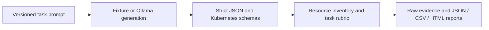

# IaC Eval Bench

[](https://github.com/devgprime/iac-eval-bench/actions/workflows/ci.yml)

A small, reproducible benchmark for **LLM-generated Kubernetes configuration**. It combines offline schema validation, explicit task requirements, failure analysis and a resumable Python evaluation workflow.

**Status: research/engineering prototype, v0.2.0 / suite v2.** Six original synthetic tasks and 50 rubric checks. Published evidence includes **constructed fixture baselines** and a [single-task real-model pilot](results/2026-10-17-qwen25-coder-15b-pilot/README.md) using Qwen2.5-Coder 1.5B Q4_K_M: 0/1 task passes, 48.96 seconds generation-request latency. This is one CPU-only observation, not a model comparison or full-suite baseline. No cloud resources are created. See the [scoring audit](docs/scoring-audit.md) for corrected errors and regression coverage.

## What it measures

| Task | Configuration requirement |
| --- | --- |
| `deployment-resources` | Replica count, resource requests/limits and readiness |
| `service-routing` | Workload labels, Service selection and named port routing |
| `network-isolation` | Namespace/pod selector conjunction and constrained DNS egress |
| `cronjob-bounds` | Schedule, concurrency, retry and execution bounds |
| `workload-hardening` | Declared privilege restrictions and disruption budget |
| `configmap-wiring` | Immutable configuration and correct workload references |

The evaluator checks JSON against bundled Kubernetes **1.34.0** strict schemas, verifies the exact requested resource inventory, then scores task requirements. Model output is treated as data and never executed. Schema validity is not full API-server admission validation, runtime correctness or a complete security assessment.



## Quick start

Python 3.11–3.13. From a fresh clone:

```bash
python -m venv .venv
source .venv/bin/activate
python -m pip install -r requirements.lock
python -m pip install --no-deps -e .
iac-eval tasks
iac-eval run --provider fixture --fixture-dir fixtures/reference --output runs/reference
```

Open `runs/reference/report.html`. The directory also contains `run.json`, one atomic record per attempt, `records.jsonl`, `results.csv` and `summary.json`.

Run the deliberately incorrect fixtures:

```bash
iac-eval run --provider fixture --fixture-dir fixtures/mutated --output runs/mutated
```

Expected: reference **6/6** task passes; mutated **0/6**, with one designated requirement failure per task. The mutated examples still pass schema validation. [Published baseline evidence](baselines/README.md) includes raw records and per-check outcomes. These results test the evaluator itself; they do not establish model quality.

## Run a model

Start an Ollama server and make your chosen model available, then:

```bash
iac-eval run --provider ollama --model YOUR_MODEL \
  --endpoint http://localhost:11434 --repeat 3 --seed 42 \
  --temperature 0 --output runs/model-a
```

The adapter uses Ollama's non-streaming `/api/generate` endpoint with JSON output mode. It records the requested model, returned model metadata, seed, temperature, elapsed request time and token counts when reported. Use `--model-revision DIGEST` to record a known model digest; that value is user-supplied, not verified by the harness. Model names can be mutable. Pin your model weights and record server/hardware details when comparing runs.

Cost defaults to **unknown**. To calculate a token-based estimate, explicitly provide both `--input-rate` and `--output-rate` in USD per million tokens. This is an estimate using your rates, not an invoice or local compute/electricity cost. No provider prices are hardcoded. Fixture generation latency and token usage are also unknown, rather than reported as zero.

Resume an interrupted run with the **same arguments** plus `--resume`. Saved attempts are reused, including provider failures; there are no automatic retries or best-of selection. Use a new output directory for a fresh experiment. Different task, schema, fixture, generation configuration, evaluator content or validation runtime causes resume to fail. Stored manifest provenance is also checked. A `SIGKILL` may leave `.run.lock`; confirm no runner is active before removing that lock.

For an external model response already saved as text:

```bash
iac-eval score --task service-routing --response candidate.json
```

`iac-eval tasks --json` exports the exact prompts without reference answers. Model adapters receive prompts, not the reference fixtures or grading rules.

## Read the results correctly

- **Quality pass rate:** all required checks passed / completed responses. Provider failures are excluded.
- **Operational pass rate:** passing responses / all attempts. Provider failures remain in the denominator.
- **Macro score:** mean of each task's mean rubric score over completed responses. Parse, schema and resource-inventory failures score zero. Requirements are equally weighted within a task.
- **Coverage:** completed-task coverage is explicit. Operational macro score includes provider errors as zero before averaging task means.
- **Latency:** wall-clock generation-request p50/p95, nearest-rank convention; includes network and model loading, excludes evaluation. Fixture latency is absent.
- **Usage/cost:** only supplied values are counted. Coverage is reported; incomplete total cost is unknown.

A high partial score can coexist with zero task passes. Both are reported. This suite is small, public and intentionally constrained. Some fields require exact representations stated in the prompt; it is not an equivalence solver. Repeated fixtures are not independent samples. Public examples can contaminate model evaluation. See [methodology](docs/methodology.md) before making comparisons.

## Development and contributions

```bash
python -m pip install -r requirements-dev.lock
python -m pip install --no-deps -e .
ruff check .
ruff format --check .
python -m unittest discover -s tests -v
python scripts/verify_baselines.py --output runs/baseline-check
python -m build --no-isolation
```

CI runs the test suite and positive/negative baselines on Python 3.11, 3.12 and 3.13, builds a wheel and checks its bundled data from outside the checkout. Reports are uploaded as artifacts. See [CONTRIBUTING.md](CONTRIBUTING.md) for task requirements and [the roadmap](docs/roadmap.md) for scoped work.

## Provenance and license

Code, prompts and fixtures were newly authored for this project with AI assistance. No private or employer evaluation materials were copied. MIT applies to original project content. Bundled schemas retain their upstream Apache-2.0 notice; [THIRD_PARTY_NOTICES.md](THIRD_PARTY_NOTICES.md) records source URLs, revision and checksums.

This is an independent project. It is not affiliated with Kubernetes, Ollama, Harbor, Terminal-Bench or an upstream evaluation organization.
