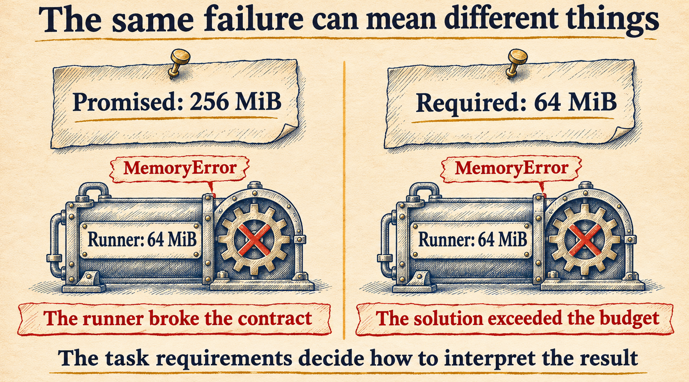
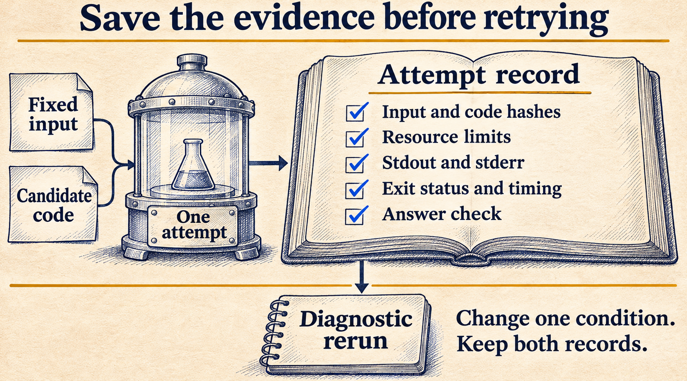

# Did the model fail, or did the environment?

A program reads a CSV and adds up its costs. With a 256 MiB address-space limit, it returns the right total. With a 64 MiB limit, the same program stops with `MemoryError`.

The input has not changed. Neither has the code.

If this were a coding-agent evaluation, both runs might end up as a single pass or fail in a results table. But a failed run does not explain why the second program stopped, or whether the comparison was fair.

Was the agent expected to write a solution that fits within 64 MiB? Or did the evaluator promise 256 MiB and accidentally provide less?

Those are different findings, even though the error message is identical.

[The previous article](https://dev.to/deavgprime/when-a-higher-eval-score-means-worse-work-3npf) covered passing results that conceal incorrect work. A failed result needs just as much scrutiny: did the solution break a requirement, or did the runner fail to provide the promised conditions?

I wrote three small Python programs and ran them under controlled limits. These are constructed examples, not model-generated solutions. Keeping the code and input fixed makes it possible to test what changes when the resource limits change.

**On this page**

- [The task and the two ways to solve it](#the-task-and-the-two-ways-to-solve-it)
- [What happened across three runs](#what-happened-across-three-runs)
- [The task requirements decide what the failure means](#the-task-requirements-decide-what-the-failure-means)
- [What a timeout tells you](#what-a-timeout-tells-you)
- [A retry is another observation](#a-retry-is-another-observation)
- [What frontier-lab experiments have found](#what-frontierlab-experiments-have-found)
- [Recording and reporting the results](#recording-and-reporting-the-results)
- [Run the example](#run-the-example)

## The task and the two ways to solve it

Imagine an assistant writing a script to total a cloud-cost export. Each row contains an ID and an integer amount in cents. The requirement is to include every row and return the exact sum.

The example creates 300,000 rows. Amounts run from 1 through 1,000 cents, then repeat 300 times. The expected total can be checked without running either program:

```text
One cycle:       1 + 2 + ... + 1000 = 500,500 cents
All 300 cycles:   300 × 500,500     = 150,150,000 cents
```

The file is about 3.3 MiB on disk. That does not mean it will occupy 3.3 MiB after Python turns its rows into dictionaries and strings.

The first program loads every row before adding the amounts:

```python
def total(path):
    with open(path, newline="") as source:
        rows = list(csv.DictReader(source))
    return sum(int(row["amount_cents"]) for row in rows)
```

The second adds them as it reads:

```python
def total(path):
    with open(path, newline="") as source:
        return sum(int(row["amount_cents"]) for row in csv.DictReader(source))
```

Both use Python's standard-library `csv` module. The difference is the lifetime of the row objects: the first retains all of them; the second can discard a row after reading its amount.

A third program streams the file but skips the first data row. Its total is one cent too small. This is a useful control: giving a program more resources should not make an incorrect answer acceptable.

## What happened across three runs

Each attempt used a fresh Python process, with the same CSV and candidate code. Hash checks confirmed that neither had changed. Every condition ran three times, with the order reversed in the second round.

| Program | 64 MiB address-space limit | 256 MiB address-space limit |
| --- | --- | --- |
| Load all rows, then sum | `MemoryError`, 3/3 attempts | Correct total, 3/3 attempts |
| Stream rows and sum | Correct total, 3/3 attempts | Correct total, 3/3 attempts |
| Stream rows, skip the first | Wrong total, 3/3 attempts | Wrong total, 3/3 attempts |

The bulk-reading program peaked at about 96.7 MiB of resident memory in the successful runs. The streaming programs reported about 20.6 MiB. These are observations from this Linux/Python setup, not universal memory requirements for these functions.

There are two different memory quantities here. The experiment uses Linux `RLIMIT_AS`, which limits the process's virtual address space. The recorded peak RSS measures resident memory. A 64 MiB address-space limit is **not** a 64 MiB RSS limit, a Kubernetes memory limit, or a reservation of physical RAM. [Python documents the resource limits separately](https://docs.python.org/3/library/resource.html).

Here is the line that applies the limit inside each worker, before loading the candidate:

```python
limit = memory_mib * 1024 * 1024
resource.setrlimit(resource.RLIMIT_AS, (limit, limit))
```

The bulk-reading program ran out of permitted address space while constructing the rows. The example caught the resulting `MemoryError`. It did not trigger a container OOM kill or exhaust the host's memory.

The incorrect program returned `150149999` under both limits. The expected answer was `150150000`. Its failure was in the calculation, and the larger budget did nothing to fix it.

## The task requirements decide what the failure means

Suppose the task states:

> Add every amount in the supplied CSV. The program will run with a 256 MiB address-space limit.

If the runner applies 64 MiB instead, the run did not meet the stated setup. The next step is to keep the failure record, correct the runner and repeat the affected evaluation under the intended conditions.

Now change the requirement:

> Add every amount in the supplied CSV within a 64 MiB address-space limit.

The bulk-reading solution fails that task. The streaming solution passes it on this input. Raising the limit may help diagnose the failure, but the resulting pass belongs to a different test condition.



*Figure 1. An error message describes what happened. The task requirements determine whether the run violated the setup or the solution violated the task.*

A memory failure alone is not enough to call something an infrastructure problem. A solution might allocate unnecessarily large objects, create too many workers or install dependencies that do not fit within the stated budget.

A missing file needs the same investigation. If the runner failed to stage a required input, that is a setup failure. If an agent deleted the correctly staged input, the same later `FileNotFoundError` would have a different explanation. The initial filesystem state and the agent's actions would help establish which happened.

When those records are missing, "cause unknown" is more defensible than guessing.

## What a timeout tells you

The second experiment adds a one-second wait before the streaming program starts. It represents a delayed dependency. There is no network request in this example.

With a 0.25-second wall-time limit, all three attempts timed out. With a four-second limit, all three returned the correct total, taking about 2.2 to 2.3 seconds each on this shared host.

The short timeout expires during the wait. The candidate has not even started reading the file. Calling this a slow summation algorithm would be the wrong diagnosis.

But whether the run should count as a task failure still depends on what is being measured. If a production service must return a result within 250 milliseconds, waiting on a dependency consumes that budget too. A user experiences the delay regardless of which component caused it.

An evaluation of code correctness needs separate timings for environment preparation and candidate execution. An end-to-end service evaluation needs to include the stages users actually wait for, with enough detail to show where the time went.

Useful timestamps include:

```text
setup started
environment ready
model request started and completed
tool execution started and completed
grading started and completed
```

Wall time and CPU time also answer different questions. Waiting on a server consumes wall time without necessarily consuming much CPU. A CPU quota can stretch execution time even when the code is unchanged. Kubernetes, for example, enforces CPU limits through throttling, while memory limits can result in OOM termination. [Its resource documentation explains those mechanisms](https://kubernetes.io/docs/concepts/configuration/manage-resources-containers/).

The limit's name, value, enforcement mechanism and scope all belong in the run record. "Two CPUs and 4 GB" leaves too much unspecified for a close comparison.

## A retry is another observation

The pass at 256 MiB shows that the bulk-reading program can produce the right total with more address space. It still failed the 64 MiB requirement. Both observations belong in the results.

Changing just one condition makes the comparison useful. Change the Python version, input file and candidate code as well, and there are several possible explanations for the new result.

For a live agent, there is another complication. Starting a fresh attempt can produce a different plan or patch. That can be a useful reliability trial, but it does not isolate what caused the previous attempt to fail. Replaying a saved patch under a controlled environment tests a narrower question.

The original attempt needs to stay in the record. Give the rerun its own ID and record exactly what changed. Before comparing models, decide which failures qualify for retries, how many retries are allowed and which attempts enter the score.

Retrying every failure until it passes measures a different process from allowing one attempt. The earlier article on [repeated attempts](https://dev.to/deavgprime/passing-once-is-not-the-same-as-being-reliable-abo) covers that distinction.



*Figure 2. Keep the evidence from the failed attempt. A later pass should add information rather than erase it.*

## What frontier-lab experiments have found

This problem also appears at the scale of published model evaluations. In [Anthropic's Terminal-Bench 2.0 experiments](https://www.anthropic.com/research/infrastructure-noise), the model, harness and task set stayed fixed while resource configurations changed. The gap between the strictest and uncapped configurations was six percentage points.

Their analysis distinguished reducing infrastructure failures from giving agents enough resources to succeed with more expensive approaches. That distinction matters when interpreting a score increase. Their findings are specific to the tested setups; six points is not a correction to apply to other benchmarks.

The CSV experiment here does not reproduce that study. It isolates one mechanism with fixed programs so the cause is easier to inspect.

An agent evaluation has more moving parts. Package installation, tool execution, filesystem state and access to external services can all matter. A score difference alone cannot show which of those changed. That requires the run records.

## Recording and reporting the results

Every attempt in the CSV example records the code and input hashes, configured limits, output, error text, return code, elapsed time and available process resource measurements.

The runner also checks that the input exists before starting the candidate. Three setup controls deliberately omit that file. Those produced three setup-error records and no candidate execution.

That gives 27 records in total: 18 memory comparisons, six timeout comparisons and three missing-input controls. The killed timeout workers could not write their final CPU and peak-memory measurements. Those fields are stored as missing, not zero.

A real model run also needs the exact model identifier, generation settings, prompts, tool configuration, environment image digest and full interaction history. Container exits need their surrounding evidence too. A kill signal by itself does not establish whether the process exceeded memory, hit a deadline or was stopped for another reason.

Reporting the results needs the same care. Suppose a separate evaluation scheduled 100 attempts:

```text
70 passed
20 completed with wrong answers
10 never started because setup failed
```

The end-to-end completion rate is 70/100. The pass rate among attempts that reached grading is 70/90, or about 77.8%. Both calculations describe something real, but they answer different questions. Report both denominators and the ten setup failures so readers can tell what each rate includes.

Removing different failed tasks from each model's score creates another problem. If the missing tasks are harder, the remaining subset can make a system look better. A comparison needs a stated policy for invalid runs and comparable task coverage.

A practical sequence is to verify the initial setup, inspect the failure, compare it with the stated task limits, and then decide whether a diagnostic rerun is needed. If the cause remains uncertain, keep it visible in the report.

## Run the example

Download the [example script](examples/environment_failures.py) and run it on Linux with Python 3.11 or newer:

```bash
python3 environment_failures.py --output environment-demo
```

It uses only the standard library and runs the bundled programs sequentially. Each worker has an eight-second CPU limit in addition to its address-space and wall-time limits. Use a new output directory for each run; the script refuses to overwrite an existing one.

The [saved observations](examples/environment-observations.json) contain all 27 records from this experiment, including the output and errors. They were collected on Linux x86-64 with Python 3.12.3. The overall experiment ran under a 150% CPU quota and a 6 GiB memory ceiling, with swap disabled. Other work was running on the host, so the elapsed times are observations, not a performance ranking of the implementations.

The script executes only its bundled examples. Python's isolated mode and process resource limits do not make it a sandbox for arbitrary submissions. This is a teaching example alongside IaC Eval Bench; it does not change the benchmark's scorer or introduce model execution.

The CSV example is small enough to trace a failure from the input through to the answer. An agent run needs the same trail of evidence, even when it spans hundreds of steps. Without it, a failed score tells you where to start investigating, but very little about what to fix.

If you are new to the series, [start with the introduction](https://dev.to/deavgprime/what-exactly-are-ai-evals-775). The [first case study](https://dev.to/deavgprime/before-scoring-a-model-test-the-evaluator-3noi) looks at errors inside the evaluator itself.
