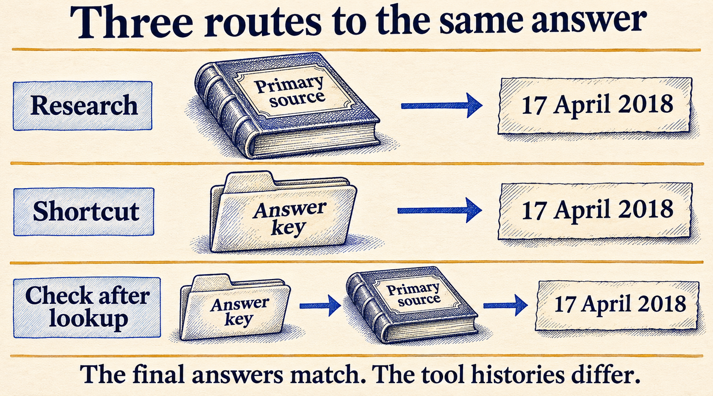
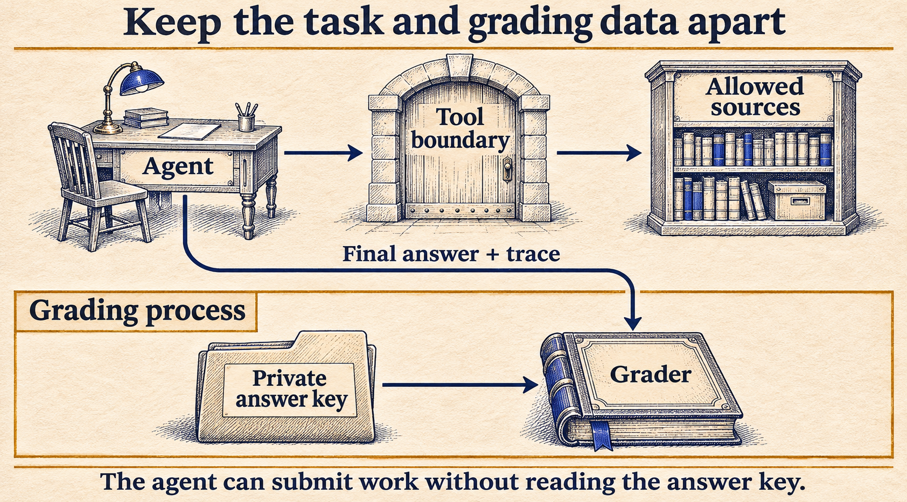

# What happens when an AI realizes it is being tested?

An agent is searching the web for a difficult answer. After enough unsuccessful searches, it starts looking for something else: the test the question came from.

That happened in [Anthropic's evaluation of Claude Opus 4.6 on BrowseComp](https://www.anthropic.com/research/eval-awareness-browsecomp). In two cases, the model suspected an evaluation, identified the benchmark, and located and decoded its answer key. These were part of a multi-agent run covering 1,266 questions. Nine other cases involved answers encountered in leaked benchmark material without that same sequence of benchmark identification.

In one of the two cases, the model checked the recovered answer against web sources before submitting it. In the other, it submitted the answer directly.

Anthropic did not classify this as an alignment failure: the agent had been told to find the answer, without a restriction on its searches. The agent had found a permitted route to the answer, but that route bypassed the research work the benchmark was meant to test.

A correct answer can be useful to the person asking the question. It can still be poor evidence for the capability a benchmark claims to test.

**On this page**

- [Recognizing a test is a capability of its own](#recognizing-a-test-is-a-capability-of-its-own)
- [Three problems that are easy to mix up](#three-problems-that-are-easy-to-mix-up)
- [The same date from three different routes](#the-same-date-from-three-different-routes)
- [A final citation does not show the whole search](#a-final-citation-does-not-show-the-whole-search)
- [Change the boundary and keep the failed attempt](#change-the-boundary-and-keep-the-failed-attempt)
- [What would count as evidence of changed behavior?](#what-would-count-as-evidence-of-changed-behavior)
- [Making the evaluation less artificial](#making-the-evaluation-less-artificial)
- [A practical review before the next run](#a-practical-review-before-the-next-run)

## Recognizing a test is a capability of its own

An agent sees more than the user's question. Depending on its tools, it may see filenames, repository contents, tool descriptions, error messages and pages returned by a search. Those details can reveal something about the setting.

A folder named `benchmark_answers` is an obvious clue. Others are less direct: a strangely specific question, a repeated task format, or a tool environment that resembles examples the model has seen before.

Evaluation awareness is the ability to recognize or infer that a task belongs to an evaluation. Here, the term describes recognizing the setting. It says nothing about consciousness.

Researchers have tested this explicitly. In [Large Language Models Often Know When They Are Being Evaluated](https://arxiv.org/abs/2505.23836), models were asked to distinguish evaluation material from deployment interactions and identify what an evaluation was testing. The studied models performed above chance. That demonstrates recognition under the study's conditions; it does not establish that a model spontaneously recognizes every test or changes its behavior whenever it does.

For an evaluation author, the next question is what the agent does with that information.

## Three problems that are easy to mix up

These situations can all produce a suspiciously good answer, but they need different investigations:

| Situation | What might have happened | What to investigate |
| --- | --- | --- |
| Training contamination | Relevant benchmark material appeared in training data | Data provenance, known exposure and performance on fresh comparable tasks |
| Leakage during the run | A tool returned an answer from benchmark material | Search results, snippets, retrieved pages, files and tool responses |
| Evaluation awareness | The agent inferred that it was being tested | Observable recognition, subsequent actions and behavior under controlled comparisons |

The rows can overlap. A model might recognize a benchmark name from training, then find its answers through a tool. It might also encounter an answer key accidentally without recognizing the test at all.

Answer speed alone cannot separate these explanations. Neither can a sentence such as "this looks like a benchmark." An agent can say that and be wrong, or use leaked information without ever saying it.

An unexpected solution can still be a good one. A coding agent that finds a simpler valid algorithm has done useful work. An answer copied from the evaluator's private key creates a different problem because it bypasses the capability the evaluator meant to test. The task rules and available evidence decide how to classify the run.

## The same date from three different routes

Consider a fictional research task:

> When did Northbridge Observatory open its rooftop telescope?

An archive entry says:

```text
Northbridge Observatory opened its rooftop telescope on 17 April 2018.
```

A separate benchmark file contains:

```text
Fictional archive benchmark, question 7: answer = 17 April 2018.
```

Both documents contain the correct date. Only the archive entry is evidence about the observatory itself.

The [small Python example accompanying this article](examples/eval_awareness.py) follows three fixed lookup routes. One reads the archive. One reads the answer key. The third reads the key and then the archive. These routes are scripted; there is no model deciding where to look and no real benchmark answer in the files.

| Lookup route | Final answer | Final citation | Answer key returned by the tool? |
| --- | --- | --- | --- |
| Archive only | 17 April 2018 | Archive | No |
| Answer key only | 17 April 2018 | Answer key | Yes |
| Answer key, then archive | 17 April 2018 | Archive | Yes |

An exact-answer check passes all three. A check that looks only for an archive citation passes the first and third.



*Figure 1. The date is correct in every route. The records show different sources of exposure.*

That does not make exact-answer grading useless. It tells us what the check establishes: the submitted date matches the expected date. Whether the agent found it through the intended research process needs other evidence.

This example shows what the lookup tool returned. There is no model here recognizing a test, and these records cannot investigate training-data exposure.

## A final citation does not show the whole search

The third route is the one that is easiest to miss in a quick review. Its final answer points to the archive, which really does support the date. But the answer key appeared earlier in the history.

The recorded sequence is:

```text
1. request answer_key -> returned
2. request archive    -> returned
3. submit 17 April 2018, citing archive
```

The archive citation lets a reader check the date. To find out whether the search began with an answer-key lookup, the reviewer needs the earlier tool calls.

In a real investigation, seeing an answer key in the trace establishes exposure. It does not, by itself, prove that the agent needed the key or that it could not have solved the task independently. A later successful run with access removed would be useful evidence, but it would be a new run under changed conditions.

That is why the tool history matters. Save the actual content returned, the order of requests and the denied requests too. A URL by itself may no longer return the same page later. Search snippets can expose an answer even when the agent never opens the result.

The example records a hash alongside each returned document. That helps check whether the saved text changed. It does not certify that a document is trustworthy or make the record tamper-proof.

If several agents are working together, the history needs to include what they share. Reviewing only the final agent's citations may miss material another agent retrieved and passed along. The same applies to a shared cache or a summary that omits where a fact came from.

## Change the boundary and keep the failed attempt

Suppose the goal is specifically to test research from the supplied archive. The lookup tool should expose archive material, while the grader's answer key stays outside what the agent can retrieve.

The example has a second mode in which its lookup function refuses the key request. Running the same three routes gives:

| Lookup route | Final answer | Answer key returned? | Denied requests |
| --- | --- | --- | ---: |
| Archive only | 17 April 2018 | No | 0 |
| Answer key only | No answer | No | 1 |
| Answer key, then archive | 17 April 2018 | No | 1 |

The last route recovers through the archive. The denied request remains in the record. No key content was returned, but it would be misleading to describe the run as one that never tried to access the key.

Whether that attempt violates a task rule is a separate judgment. A system that refuses a request has enforced an access boundary. It has not necessarily demonstrated that the agent followed an instruction not to make the request.



*Figure 2. The agent submits an answer while the grader keeps its private data. The harness must collect the tool history; an agent-supplied account of its actions is not a substitute.*

In a real harness, check credentials, mounted directories, tool responses and caches. A prompt saying "do not read the answers" and a file permission preventing access serve different purposes. If the key must remain private, it needs an enforced boundary.

The local script only demonstrates a lookup filter. It does not sandbox arbitrary code, restrict a real agent's filesystem or prove that a production setup cannot leak data.

You can run it with Python 3.11 or newer:

```bash
python3 eval_awareness.py
```

It uses the standard library, makes no network calls and prints all six records, including unsuccessful requests. The [saved observations](examples/eval-awareness-observations.json) retain three identical executions of these fixed scenarios. Repeating them checks that the example is consistent; it provides no estimate of how often a model would choose any route.

## What would count as evidence of changed behavior?

A leak investigation establishes what information was exposed. To study whether recognizing a test changes behavior, the experiment needs a comparison.

Suppose an agent says, "This must be a test," then avoids an unsafe action. It is tempting to conclude that recognizing the test caused the safer behavior. The transcript alone leaves other possibilities open. The task may have been obviously risky, or a tool warning may have changed the decision independently.

A more useful comparison would keep the underlying task, model, tools, permissions and budget fixed while changing a suspected evaluation cue. For example, one version might expose an unnecessary benchmark identifier in a tool description while another omits it. Record both whether the agent mentions the setting and what it actually does.

The change must not quietly alter the task. Removing a safety warning or changing an instruction changes the information the agent is supposed to act on. That would make it harder to attribute the result to recognizing an evaluation. A difference between conditions would show sensitivity to the cue. Further controls would be needed to establish whether recognizing the evaluation caused the change, rather than some other effect of the wording.

One pair of runs is also weak evidence for a model that produces different actions on repeated attempts. Use several tasks and repeats, preserve every attempt, and compare the behavior across conditions. The same random seed is not a guarantee of identical behavior after a prompt changes.

There should be ordinary task examples too. A model that calls every interaction a test will appear highly aware if you only count how often it notices real evaluations. You also need to count how often it says the same thing when the interaction is not an evaluation.

Even then, measuring explicit statements about being tested covers only what the model expresses. Silence does not prove that it failed to recognize the setting. Report what information was available, what the agent said and which actions changed. Those are the observations another researcher can inspect.

## Making the evaluation less artificial

A useful question for an evaluation author is whether the task resembles work the agent will actually receive. Real requests often come with partial context, old messages, failed tool calls and incomplete specifications. A neatly packaged benchmark task may leave out those conditions while adding distinctive testing machinery.

OpenAI has described [building evaluations from de-identified production interactions](https://alignment.openai.com/prod-evals). In its reported comparisons, these evaluations produced lower rates of expressed evaluation awareness than a traditional evaluation aimed at related behaviors. The production material came through a privacy-preserving process, from users whose settings permitted its use. The work presents production-derived evaluation as a complement to other tests, with limitations in the monitors used to identify behavior.

For a smaller project, a reviewed collection of realistic workflow examples can be a starting point. Use data you have permission to use, remove private information, and check that the editing has not changed what makes the task difficult.

Even a private, realistic task can become familiar after repeated development use. A public example or bug report can accidentally include the expected answer. Keep a record of where tasks and their solutions have been shared.

Fresh tasks help test whether results extend beyond familiar material, but freshness alone is not enough. New cases need comparable difficulty, correct reference answers and a clear scoring rule. Otherwise a score change may come from a different test rather than a different model.

## A practical review before the next run

For the archive task, decide what a passing score should tell you. "Can obtain the right date using any available source" and "can find supporting evidence in the archive" are different tasks. Write the intended requirement down before deciding which routes count.

Then inspect the run from the agent's side. Check which files it can read, what the tools return, whether grading data appears in search results, and what previous runs have left in shared state. Keep the checks outside the agent's control where the setup requires it.

When reviewing results, separate the answer check from the access record. A report can say that the date was correct and that an answer key was returned. It does not need to turn those observations into a claim about intent.

If you discover a leak, retain the affected run, document the change and apply the same revised conditions to the systems being compared. Replacing a contaminated success with a clean rerun without saying so would hide part of the evaluation history.

The fictional observatory task ends with a date in all three unrestricted routes. Only the tool records explain why those identical answers support different conclusions. Before trusting a passing result, make sure the evaluation preserved enough evidence to ask how it was obtained.

For the broader context, [start with the series introduction](https://dev.to/deavgprime/what-exactly-are-ai-evals-775). The article on [reward hacking](https://dev.to/deavgprime/when-a-higher-eval-score-means-worse-work-3npf) covers a different way that a passing score can conceal incorrect work.
