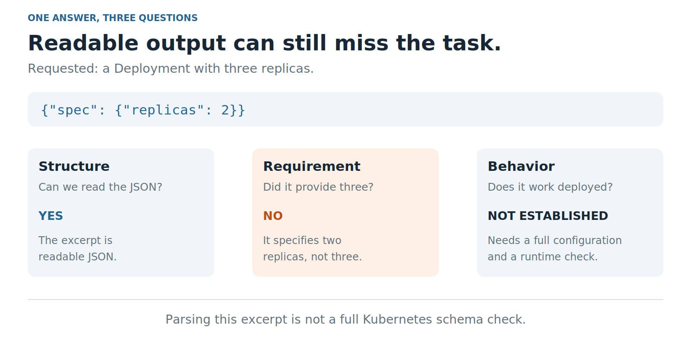
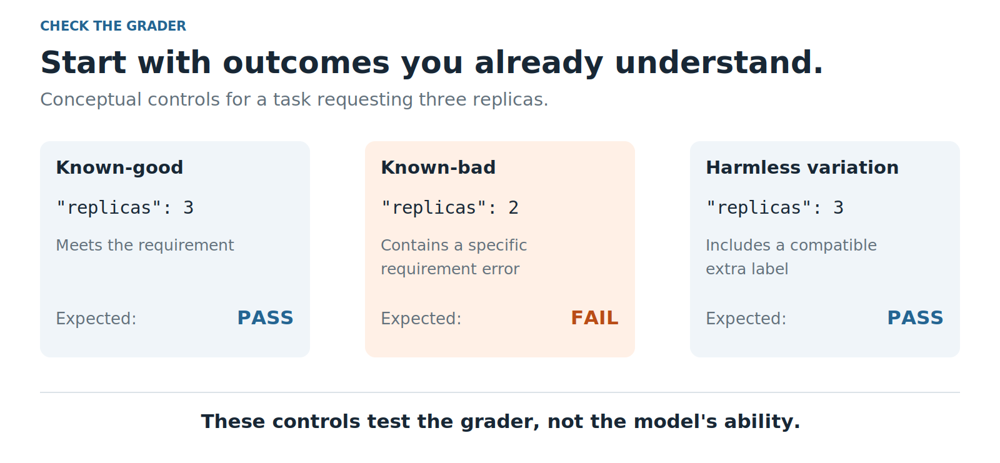
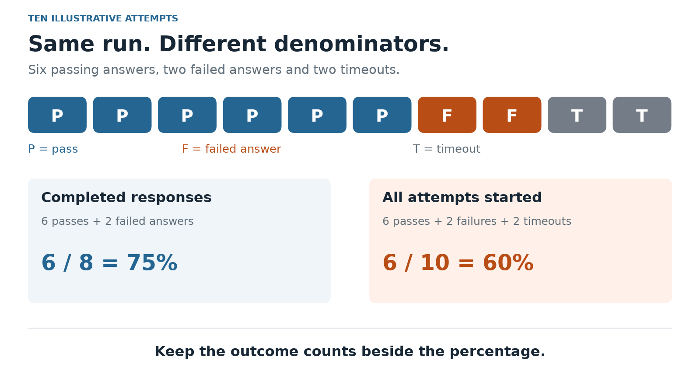

# What exactly are AI evals?

You ask an AI to write a configuration. It returns something that looks reasonable, explains what it did, and says the result is ready.

Would you use it?

Reading the answer might catch an obvious mistake. But if you change the prompt tomorrow, how will you know whether the new version is better? What if it fixes one example and breaks another?

That is where evaluations, usually shortened to **evals**, become useful.

I want to start this series with the basics. The case studies that follow will make more sense if we agree on what we are measuring, how we judge it, and what a score can leave out.

**On this page**

- [What an eval actually does](#what-an-eval-actually-does)
- [One answer, three different questions](#one-answer-three-different-questions)
- [The parts of an eval](#the-parts-of-an-eval)
- [How many types of evals are there?](#how-many-types-of-evals-are-there)
- [How to design a useful first eval](#how-to-design-a-useful-first-eval)
- [Who checks the grader?](#who-checks-the-grader)
- [Why the same run can produce two percentages](#why-the-same-run-can-produce-two-percentages)
- [Where our case study fits](#where-our-case-study-fits)
- [The reading list for this series](#the-reading-list-for-this-series)

## What an eval actually does

An eval tests an AI system against a defined expectation and records what happened.

That expectation needs to be more useful than “give me a good answer.” For example:

- Produce a configuration with exactly three replicas.
- Answer using only the supplied document.
- Fix a bug without breaking the existing tests.
- Move a meeting to the requested time without changing its attendees.

The eval gives the system a task, collects its answer or actions, and checks them against the success criteria. **A score is a result of that process, not the whole process.**

For an agent that can take actions, its final message is only part of the evidence. Saying “I moved the meeting” does not establish that the calendar changed. We need to inspect the resulting state too. Anthropic makes this distinction between a recorded interaction and its actual outcome in its [agent evaluation guide](https://www.anthropic.com/research/demystifying-evals-for-ai-agents).

This also explains why an eval can contain ordinary software tests. A unit test may be one of its checks. The larger evaluation adds the chosen tasks, run conditions, repeated attempts where appropriate, and the records we need to interpret the results.

Running an eval does not, by itself, train or improve the model. We use its findings to decide what to change, then test again. The change might be in a prompt, a retrieved document, a tool, application code, or the model itself.

## One answer, three different questions

Here is the running example for this article:

> Create a Kubernetes Deployment with three replicas.

Kubernetes runs applications, and a replica is a copy of a workload. You do not need to know Kubernetes to follow the example: we asked for three copies.

Suppose the answer contains this excerpt:

```json
{"spec": {"replicas": 2}}
```

It is readable JSON. But it says two, not three.

Now separate the questions:

1. **Structure:** Can we read the answer in the requested format?
2. **Requirement:** Does it contain the setting we asked for?
3. **Behavior:** Does the complete configuration work when deployed?

The excerpt answers the first two questions. It cannot establish the third. It is also not a complete Kubernetes manifest, so accepting this JSON does not establish full schema validity.



*Figure 1. An illustrative example. Readable output can still miss a requirement, and neither observation proves runtime behavior.*

An eval should say which of these questions it checks. Otherwise, “passed” is easy to overinterpret.

## The parts of an eval

The terminology becomes easier when we attach each word to the same example.

| Term | What it means here |
| --- | --- |
| **Task or test case** | The request, its inputs, and the criteria for success. |
| **Dataset** | The collection of examples we choose to test. |
| **Evaluation suite** | A group of evaluations covering selected behaviors or capabilities. |
| **System under test** | The model, application, or agent whose behavior we are examining. |
| **Trial** | One attempt at a case. Repeating a case creates more trials. |
| **Grader or scorer** | The method that checks an answer and assigns a result. |
| **Score** | A result for one case, such as pass/fail or partial credit. |
| **Metric** | A summary across results, such as a pass rate. |
| **Harness** | The software that runs the cases and saves the evidence. |

Frameworks use these words somewhat differently. In Inspect AI, a task brings together a dataset, a solver that produces answers, and a scorer that grades them. Its [task documentation](https://inspect.aisi.org.uk/tasks.html) shows how those pieces fit together.

A benchmark is usually a defined collection of tasks and a way to report performance. A public benchmark can be useful for comparisons. A project-specific eval asks whether a system meets the requirements of that project. Doing well on one does not automatically answer the other question.

## How many types of evals are there?

There is no single, fixed number that covers all the ways people use the word. Different labels answer different questions.

I find it easier to sort them along three separate axes.

### What are we evaluating?

- **A model:** Can it solve a problem or produce the required response?
- **An application:** Does the complete system, including prompts, retrieval, and other components, do its job?
- **An agent:** Do its tool calls and actions produce the intended outcome under the allowed conditions?

A failure in an application does not immediately tell us which component caused it. The retrieved document might be wrong even when the model follows it correctly.

### How are we grading it?

**Code-based grading** uses explicit checks: parse the output, compare a value, run tests, or inspect an environment. It works well when success can be stated precisely. It can also be wrong if the checks are incomplete or unnecessarily strict. Inspect's [custom scorer examples](https://inspect.aisi.org.uk/custom-scorers.html) show this kind of scoring logic.

**Model-based grading** asks another model to assess the response against instructions or a rubric. A rubric is a written set of judging criteria. This can help with open-ended answers, but the grader model can make mistakes too. Its judgments need comparison with trusted examples and human review. See [Inspect's model-grading guide](https://inspect.aisi.org.uk/model-graded.html).

**Human grading** uses people with the relevant understanding to review the work. It is valuable for ambiguous cases and for checking automated graders. People also need clear criteria and a way to resolve disagreements.

These methods can be combined. We can use code to check structure, a model to flag a possible factual error, and a person to review disputed cases.

We do not always need one reference answer that every response must resemble. A code change can be judged by tests, and an explanation can be judged against a rubric. The expectation still needs to be defined even when several different answers could satisfy it.

### When are we evaluating it?

- **Offline:** Run saved or constructed cases without exposing users to the candidate system's actions.
- **Shadow:** Observe how a candidate would behave on live inputs while its actions or answers are withheld from users.
- **Online:** Assess the system during real use, for example through a controlled experiment and operational monitoring.

Offline does not mean “no network.” An offline eval may call a hosted model API. It describes how the experiment relates to users and deployment.

We can also name evals by their purpose: checking a new capability, catching regressions, probing safety requirements, or measuring reliability.

So our future case study can be an **offline, code-graded evaluation of generated configurations**, used to investigate scoring reliability. Those labels fit together. They are not competing categories.

## How to design a useful first eval

Start with a decision you need to make. “Is this model good?” is too broad. “Did this prompt change improve the required configuration settings without increasing failures?” is something we can investigate.

Then work through these steps:

1. **Define success before judging the answers.** Identify the required behavior and acceptable variations. Refine unclear criteria when reviewing examples, then version the revised task and grader.
2. **Choose cases that matter.** Include ordinary requests, important edge cases, and failures you have observed. A few convenient examples are a starting point, not evidence of broad coverage.
3. **Build the simplest appropriate checks.** Use a direct assertion when a direct assertion answers the question. A model judge is not required for every eval.
4. **Compare under matching conditions.** Keep the task versions, tools, limits, and scoring rules consistent. Record what changed.
5. **Inspect the failures.** Classify whether the problem came from the system, the task wording, the environment, or the grader.

Repeat trials when the behavior varies. Keep each attempt rather than quietly replacing failures with successful retries. Repeating the same cases helps measure variation on those cases; it does not make the case collection more representative.

Correctness is not the only useful measurement. Record latency, token usage, cost, and resource use when they matter to the decision. Report these alongside the task results so readers can see what a successful attempt required.

An eval also needs records: the input, response, relevant actions, configuration, check results, and errors. Otherwise, the headline number may survive while the explanation disappears.

Hamel Husain's [practical evaluation workflow](https://hamel.dev/blog/posts/evals/) connects this work to a useful development cycle: evaluate, inspect the problems, change the system, and evaluate again.

## Who checks the grader?

This is the question that connects the introduction to our case study.

Suppose our grader only checks that `replicas` is present. The answer containing two replicas could pass even though the task asked for three.

We could get a clean report from a broken scoring rule.

Before using that grader to compare models, give it examples whose expected outcomes we understand:

- **Known-good:** A correct answer should pass.
- **Known-bad:** An answer with a specific mistake should fail.
- **Harmless variation:** A different but acceptable answer should still pass.



*Figure 2. Test the measuring instrument too. These constructed examples check the grader, not a model's ability.*

The third case is easy to overlook. An extra label that does not break a requested selector should not automatically make a configuration wrong. A grader needs to catch mistakes while respecting the task's allowed variations.

These controls still cover only the situations we chose. A passing set of controls is useful evidence, not a guarantee that the grader is complete.

## Why the same run can produce two percentages

Here is a made-up run, not a result from our benchmark:

- Ten attempts were started.
- Six produced passing answers.
- Two produced answers that failed the checks.
- Two timed out before producing an answer.

If we report passing answers among completed responses, the rate is **6/8 = 75%**.

If we report successful attempts among everything started, it is **6/10 = 60%**.



*Figure 3. Same run, different denominators. Both calculations need their definitions beside them.*

Neither rate should be presented without explaining what counts. There is also a difference between a model producing an invalid answer and a grader crashing while trying to inspect it. Inspect's [scoring policy](https://inspect.aisi.org.uk/scoring-policy.html) explains why those outcomes need separate treatment.

A partial score is another choice. An answer may satisfy several requirements and still fail the full task. “Most checks passed” and “the task passed” are different statements.

For comparisons, look beyond one percentage: case coverage, variation across runs, failure categories, and operational measurements can all matter. More trials and uncertainty estimates help describe the evidence we have; they do not repair a badly chosen dataset. Inspect documents several [scoring metrics and uncertainty measures](https://inspect.aisi.org.uk/metrics.html).

## Where our case study fits

In IaC Eval Bench, we are studying model-generated Kubernetes configuration through offline structure and task checks. We retain the responses and individual scoring outcomes.

The upcoming case study examines the evaluator itself. A review found cases where it accepted a contradictory selector and rejected an acceptable extra label. It shows why the original positive and negative examples could produce expected totals while other scoring errors remained.

That work does not demonstrate runtime correctness. It does not establish a ranking of models. It gives us specific examples of how an evaluation can mislead us, and how to test the checks more carefully.

The three questions I want readers to carry into it are:

1. What are we claiming to measure?
2. What evidence supports the grade?
3. What could make the grade wrong?

## The reading list for this series

I plan to follow this introduction with practical case studies: a reproducible example, the failure, the investigation, and the limits of the fix. Each should give readers something they can inspect or try themselves.

I will add links here as the case studies are published.

- [Before scoring a model, test the evaluator](https://dev.to/deavgprime/before-scoring-a-model-test-the-evaluator-3noi): five scoring errors in a Kubernetes evaluator and the tests that caught them.
- [Resuming an eval without changing the experiment](https://dev.to/deavgprime/resuming-an-eval-without-changing-the-experiment-c8d): keeping saved attempts, continuing missing work, and rejecting changed inputs in IaC Eval Bench.

- [Passing once is not the same as being reliable](https://dev.to/deavgprime/passing-once-is-not-the-same-as-being-reliable-abo): understanding pass@1, pass@k, and pass^k through repeated attempts, with a runnable Python example.

- [When a higher eval score means worse work](https://dev.to/deavgprime/when-a-higher-eval-score-means-worse-work-3npf): reward hacking, independent grading, and a runnable coding example with four constructed patches.

- [Did the model fail, or did the environment?](https://dev.to/deavgprime/did-the-model-fail-or-did-the-environment-403f): separating wrong answers from memory limits, timeouts and setup failures, with a runnable example.

- [Can an AI model hide how capable it really is?](https://dev.to/deavgprime/can-a-model-hide-how-capable-it-really-is-57ig): sandbagging research and how to investigate underperformance without confusing it with ordinary failure.

For the framework terminology and design choices behind this introduction, the linked Inspect, Anthropic, and Hamel Husain articles are useful places to continue reading.
