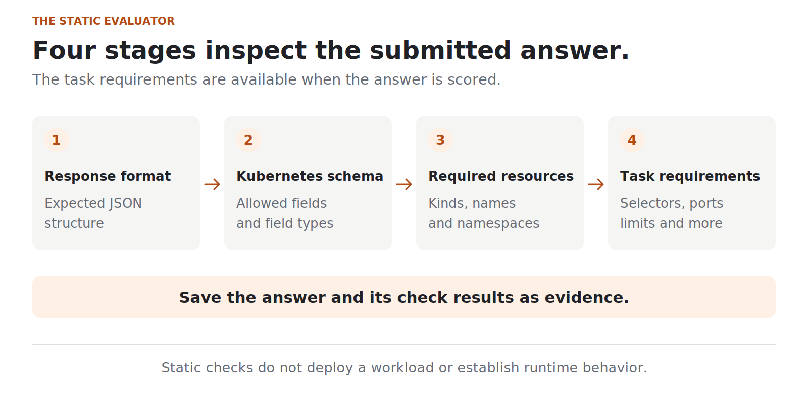
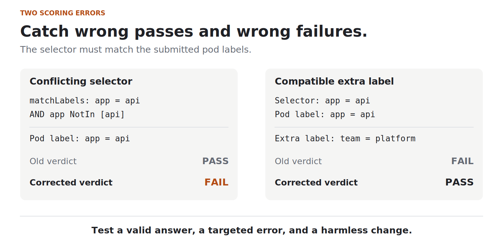

# Before scoring a model, test the evaluator

One version of my evaluator passed a Kubernetes configuration whose selector contradicted its own pod labels. It also rejected a configuration just because an extra label had been added.

**Both results were scoring errors.**

If you are new to evals, start with [What exactly are AI evals?](https://dev.to/deavgprime/what-exactly-are-ai-evals-775). It explains the tasks, graders, and metrics used in this case study.

These came up while working on [IaC Eval Bench](https://github.com/deavgprime/iac-eval-bench), a small project for evaluating model-generated Kubernetes configurations. A scoring review found five mistakes in the evaluator, even though its original reference and negative-control examples were producing the expected totals.

That last part is worth explaining. A passing test suite tells us that the cases we wrote behave as expected. We still have to ask whether we chose enough useful cases.

**On this page**

- [How the evaluator works](#how-the-evaluator-works)
- [A passing and a failing answer](#start-with-a-passing-and-a-failing-answer)
- [Two mistakes the controls missed](#two-mistakes-the-original-controls-missed)
- [All five scoring fixes](#all-five-scoring-fixes)
- [Run the checks](#run-the-checks-yourself)
- [Limits and next checks](#limits-and-next-checks)

## How the evaluator works

The benchmark has six tasks. They ask for configurations such as a Deployment with resource limits, a Service that selects the right pods, or a scheduled job with execution limits.

For each answer, the evaluator checks:

1. **The response format.** Can it read the expected JSON structure?
2. **The Kubernetes schema.** Do the fields and their types match the bundled schema?
3. **The requested resources.** Are the right resource types, names, and namespaces present?
4. **The task requirements.** Do the labels, ports, limits, and other settings satisfy the prompt?

A schema is a description of the allowed structure. For example, it can tell us that a replica count should be a number. That does not mean it checks every relationship between the fields.

The evaluator saves the answer and the outcome of its checks so a result can be inspected later.



*Figure 1. The evaluator checks configuration data without deploying it. Task requirements are available when it scores the answer.*

## Start with a passing and a failing answer

Take a Service, which directs traffic to a set of pods. Kubernetes uses labels to decide which pods the Service selects.

Here is the relevant part of a matching example. These are excerpts, not complete manifests:

```yaml
# Pod labels in the Deployment template
labels:
  app: api

# Service selector
selector:
  app: api
```

The Service asks for pods with `app: api`, and the pod template has that label.

Now change only the Service selector:

```yaml
selector:
  app: unrelated
```

Both versions have the same field structure. The second selector does not match the intended pods. The evaluator needs to check that relationship.

This is a useful negative control: a constructed answer with a mistake we expect the evaluator to catch. The unchanged answer is the positive control.

The project has one reference answer and one targeted negative example for each task:

| Constructed examples | Full task passes | Schema and resource checks passed |
| --- | --- | --- |
| Six reference answers | 6/6 | 6/6 |
| Six answers with a targeted mistake | 0/6 | 6/6 |

Those are the expected results. All six negative examples still get through the schema and resource checks. Each fails its intended task requirement.

> **Reading these results:** These are constructed examples for testing the evaluator. No model produced them, so the pass counts do not measure model ability.

## Two mistakes the original controls missed

### A broken selector passed

The original examples all behaved as expected. Then the review tried changes beyond those six negative controls.

One change added this condition to a Deployment selector:

```yaml
selector:
  matchLabels:
    app: api
  matchExpressions:
    - key: app
      operator: NotIn
      values: [api]
```

Read the two conditions together:

- The first requires `app` to equal `api`.
- The second requires `app` not to equal `api`.

They cannot both be satisfied. The selector also contradicts the Deployment's own pod template, which has `app: api`.

The old evaluator passed this configuration because it checked `matchLabels` and ignored `matchExpressions`.

The fix checks every declared selector condition against the submitted pod labels. This follows Kubernetes' rule that the conditions in a label selector must all be satisfied. [Kubernetes selector documentation](https://kubernetes.io/docs/concepts/overview/working-with-objects/labels/#label-selectors)

### A harmless label failed

Here is the other side of the problem:

```yaml
labels:
  app: api
  team: platform
```

The required `app: api` label is still present. A selector asking for `app: api` still matches these labels.

The old label check compared the whole label map with the reference map. The extra `team` entry caused a failure.

That check was too strict. It now checks for the required label while allowing compatible additions. The task wording also makes those allowed additions explicit, so the prompt and the scoring rule agree.

This matters for model evaluation. If the evaluator rejects an acceptable answer, the model gets blamed for a scoring mistake. If the evaluator accepts a broken answer, the score looks better than it should.



*Figure 2. The conflicting selector must fail; the compatible extra label must still pass. Both cases need regression coverage.*

## All five scoring fixes

The review recorded five scoring mistakes:

| Change to the reference answer | Old | Corrected |
| --- | --- | --- |
| Conflicting Deployment selector | Pass | **Fail** |
| Compatible extra pod label | Fail | **Pass** |
| Matching PodDisruptionBudget condition | Fail | **Pass** |
| Two readiness probe handlers | Pass | **Fail** |
| UDP workload port with TCP Service | Pass | **Fail** |

A PodDisruptionBudget describes how many pods should remain available during voluntary disruptions. Like the Deployment, it uses a selector to identify the relevant pods.

The [scoring audit](https://github.com/deavgprime/iac-eval-bench/blob/1dbabecd8cc377cef1082b2652131b6921c4c74b/docs/scoring-audit.md) explains the individual fixes and links the saved before-and-after observations.

The original controls were useful. They caught the mistakes they were designed to catch. But neither their old nor their corrected totals exposed these five scoring errors. Both versions reported six reference passes and zero negative-control passes.

The individual cases mattered more than those totals.

## Run the checks yourself

The examples can run locally without a model endpoint or Kubernetes cluster. With Python 3.11 to 3.13 installed:

**1. Get the version used in this article.**

```bash
git clone https://github.com/deavgprime/iac-eval-bench.git
cd iac-eval-bench
git switch --detach 1dbabecd8cc377cef1082b2652131b6921c4c74b
```

**2. Prepare the Python environment.**

```bash
python3 -m venv .venv
source .venv/bin/activate
python -m pip install -r requirements.lock
python -m pip install --no-deps -e .
```

**3. Run the tests and constructed examples.**

```bash
python -m unittest discover -s tests -v
python scripts/verify_baselines.py --output runs/article-check
```

The revision is pinned so the code stays the same when someone repeats the example. Use a fresh output directory if you run the baseline check again.

This revision has 51 test methods, including multiple cases within some tests. The baseline check should finish with:

```text
Verified: 6 reference passes; all 6 targeted semantic mutations detected.
```

The output folders retain the inputs, individual check results, and reports. Open `runs/article-check/reference/report.html` or `runs/article-check/mutated/report.html` locally to inspect them.

## Limits and next checks

These checks examine configuration data. They do not submit it to a Kubernetes API server, start a workload, or verify that an application serves traffic.

For example, a matching Service selector does not prove that the application is listening on the requested port. That needs a different kind of test.

The suite is also small: six public, synthetic tasks. Its controls and regression tests cover specific requirements and failure cases. They are not evidence that every valid configuration will pass or every invalid one will fail.

For my next evaluator change, I want to answer three questions before looking at a model score:

1. What answer should pass?
2. What specific mistake should fail?
3. What harmless change should still pass?

For this project, the third question caught a problem that the original pass/fail examples had missed.

Next in the series: [Resuming an eval without changing the experiment](https://dev.to/deavgprime/resuming-an-eval-without-changing-the-experiment-c8d). I test what happens when a run stops, which attempts are reused, and when resuming should be rejected.
