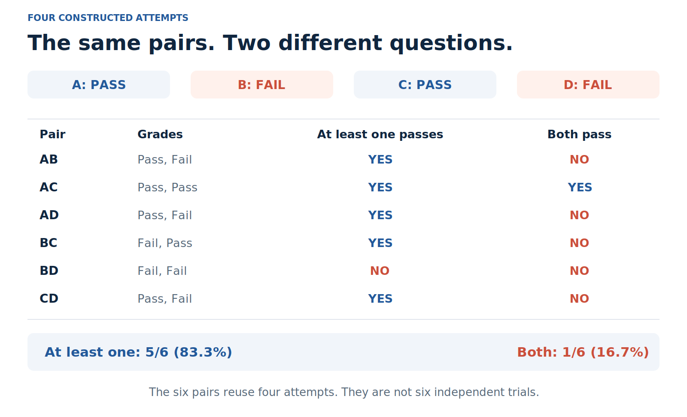
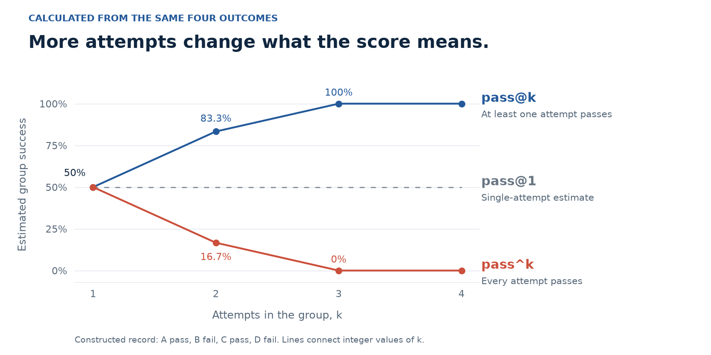

# Passing once is not the same as being reliable

Suppose a model gets a task right on its third attempt. Do we record a success?

If the question is whether it can produce a correct answer within four attempts, yes. If the question is whether someone can depend on a single answer, that result is not enough.

**The attempts have not changed. The question has.**

In [Before scoring a model, test the evaluator](https://dev.to/deavgprime/before-scoring-a-model-test-the-evaluator-3noi), I looked at mistakes in the code that grades Kubernetes configurations. This article takes the next step: once the grades are correct, what should we count?

We will use four constructed outcomes, inspect every pair, and calculate three commonly confused metrics. There are no model measurements in this example. You can reproduce the calculations with Python, without an endpoint or a cluster.

If evals are new to you, [the first article](https://dev.to/deavgprime/what-exactly-are-ai-evals-775) explains tasks, graders, and scores.

**On this page**

- [Keep the individual attempts](#keep-the-individual-attempts)
- [Three questions behind three scores](#three-questions-behind-three-scores)
- [Count the pairs yourself](#count-the-pairs-yourself)
- [What a higher score leaves out](#what-a-higher-score-leaves-out)
- [Run the calculation](#run-the-calculation)
- [What I would report](#what-i-would-report)

## Keep the individual attempts

Take a task like the ones in [IaC Eval Bench](https://github.com/deavgprime/iac-eval-bench): produce a Kubernetes Service that selects the intended pods and sends traffic to the requested port.

Imagine four fresh attempts with the same prompt, model settings, and grading rules. Each starts without seeing earlier answers or their feedback. Here is a constructed record:

| Attempt | Relevant behavior in the answer | Grade |
| --- | --- | --- |
| A | Selector and target port meet the requirements | Pass |
| B | Selector does not match the intended pods | Fail |
| C | Selector and target port meet the requirements | Pass |
| D | Target port does not meet the requirement | Fail |

Two answers passed. Two failed. Saving only answer A would hide half of what happened.

These are grades against the stated checks. A pass does not establish that the workload was deployed or that it served traffic.

## Three questions behind three scores

The notation is similar, but the questions differ:

| Metric | Question |
| --- | --- |
| **pass@1** | Does a single attempt pass? |
| **pass@k** | Among k attempts, does at least one pass? |
| **pass^k** | Do all k attempts pass? |

Here, k means the number of attempts in the group being evaluated. It does not mean the number of tasks or the number of tool calls within one attempt.

The [HumanEval paper](https://arxiv.org/abs/2107.03374) uses pass@k to evaluate whether generated code samples include a solution that passes the tests. The [tau-bench paper](https://arxiv.org/abs/2406.12045) introduces pass^k to examine consistency across repeated agent trials.

For our four outcomes, the estimate of pass@1 is 2/4, or 50%. This uses all four recorded attempts to estimate single-attempt success. It does not mean we inspect only the first answer.

Now suppose we care about groups of two attempts. Does one answer in the pair need to work, or do both need to work?

## Count the pairs yourself

There are six ways to choose two distinct attempts from A, B, C, and D:

| Pair | Grades | At least one passes | Both pass |
| --- | --- | --- | --- |
| AB | Pass, Fail | Yes | No |
| AC | Pass, Pass | Yes | Yes |
| AD | Pass, Fail | Yes | No |
| BC | Fail, Pass | Yes | No |
| BD | Fail, Fail | No | No |
| CD | Pass, Fail | Yes | No |

Five pairs contain a passing answer. Only one pair contains two passing answers.

So the estimates are **pass@2 = 5/6, about 83.3%**, and **pass^2 = 1/6, about 16.7%**.



*Figure 1. The same outcomes answer two different questions. Choosing every possible pair makes the difference visible.*

We can repeat the calculation for each group size:

| Attempts in the group, k | pass@k: at least one passes | pass^k: every attempt passes |
| --- | --- | --- |
| 1 | 50% | 50% |
| 2 | 83.3% | 16.7% |
| 3 | 100% | 0% |
| 4 | 100% | 0% |

Any group of three from these four outcomes contains a pass and a failure. That explains the last two rows without needing a formula.



*Figure 2. Calculated from the four outcomes above. The model has not improved between points; only the group size and success condition have changed. Connecting lines guide the eye between integer values of k.*

### Why not just square 50%?

If a task's true success probability were known to be 50%, independent future attempts would both pass with probability 25%. At least one would pass with probability 75%.

But we do not know that true probability from four observations. Here we are calculating estimates by choosing distinct samples from a finite record. Those are different calculations. Under independent, identically distributed attempts, the subset formulas estimate the corresponding future-attempt probabilities without the bias introduced by simply taking powers of the observed success rate.

The 100% entries above are estimates from a tiny record, not guarantees about future runs. In fact, several pairs reuse the same attempts. Six pairs are not six independent experiments.

## What a higher score leaves out

### Someone still has to choose the answer

For pair AB, the benchmark knows that A passed. A user looking at two plausible configurations may not.

If the application has a trustworthy checker, it may be able to select a passing candidate. If it uses another model to choose, that selection can fail too. Measure the answer the whole system actually returns, including its selection step.

**A correct answer existing somewhere in a batch is useful information. It is not the same as returning that answer.**

### Retries change the budget

A system allowed four attempts has a different opportunity from one allowed only one. Keep the attempt budget visible when comparing scores.

Record latency, tokens, and cost across the attempts, including failures. Parallel attempts might reduce waiting time compared with sequential attempts, but they still consume resources. If the system stops early, record when and why it stopped.

### Feedback changes the experiment

An agent that sees a validation error and edits its previous answer is running a repair process. Its later attempts depend on earlier results.

That can be a useful system to evaluate. Run the complete repair process, with a fixed budget, and score its final outcome. Do not treat its dependent steps as fresh independent samples in the calculation above. Reset the environment between trials of the whole process.

### An average can hide which tasks are unreliable

Imagine two tasks, each attempted four times. In one constructed record, the first task always passes and the second always fails. In another, each task passes twice and fails twice.

Both records have 50% pass@1. Their repeated-attempt estimates differ:

| Constructed record | Mean pass@2 | Mean pass^2 |
| --- | --- | --- |
| One task always passes; one always fails | 50% | 50% |
| Each task passes twice and fails twice | 83.3% | 16.7% |

Calculate the metric for each task, then average across tasks. Keep the per-task results as well. Taking a power of the overall pass rate would miss this difference.

## Run the calculation

For n recorded attempts with c passes, the subset estimates are:

```text
pass@k = 1 - C(n - c, k) / C(n, k)
pass^k =     C(c, k)     / C(n, k)
```

`C(a, k)` counts the ways to choose k items from a items, without replacement. It is zero when there are too few items. Choose k from 1 through n.

The first formula counts groups that are not entirely failures. The second counts groups made entirely of passes. You can inspect the reference implementations in [HumanEval](https://github.com/openai/human-eval/blob/master/human_eval/evaluation.py) and [tau-bench](https://github.com/sierra-research/tau-bench/blob/main/tau_bench/run.py).

Here is the central calculation using Python's standard library:

```python
from fractions import Fraction
from math import comb

outcomes = (True, False, True, False)
n, c, k = len(outcomes), sum(outcomes), 2

at_least_one = 1 - Fraction(comb(n - c, k), comb(n, k))
every_attempt = Fraction(comb(c, k), comb(n, k))

print(at_least_one, every_attempt)  # 5/6 1/6
```

The [complete example](https://github.com/deavgprime/iac-eval-bench/blob/9e9d0a5b2f9c2c14a0418ce60f0bb57111ab2e51/docs/examples/repeated_attempts.py) retains the outcomes, lists all six pairs, and checks both formulas against direct enumeration for every Boolean sequence of lengths one through eight and every valid k. That covers 3,586 sequence-and-k combinations, including all-pass and all-fail records. It also checks invalid inputs and task averaging.

Download that file and run:

```bash
python3 repeated_attempts.py --verify
```

It requires no additional packages. The output includes the exact fractions and a verification status of `passed`. The [saved output](https://github.com/deavgprime/iac-eval-bench/blob/9e9d0a5b2f9c2c14a0418ce60f0bb57111ab2e51/docs/examples/repeated-attempts-observations.json) is available alongside the code.

## What I would report

For a repeated-attempt eval, I would keep these together:

1. **The task and grading rule.** What does a pass actually establish?
2. **Every attempt and its result.** Include failures and record infrastructure errors separately, with a stated rule for how they affect the denominator.
3. **The sampling or repair setup.** Record model version, settings, resets, feedback, selection method, and stopping rule.
4. **The budget and measurements.** Show attempts per task, latency, token usage, and cost alongside the score.
5. **Per-task results and uncertainty.** A few attempts can explain a metric; they cannot establish dependable performance on their own.

For IaC Eval Bench, these repeated-attempt metrics are a standalone teaching example, not a new measured model result or a change to the benchmark's scoring. The next useful experiment would retain several fresh attempts per task under a fixed configuration and inspect the failures before summarizing them.

When I see a pass rate now, the first thing I want to know is what had to happen for the run to count as a pass: one successful answer, a correctly selected answer, or success every time?
