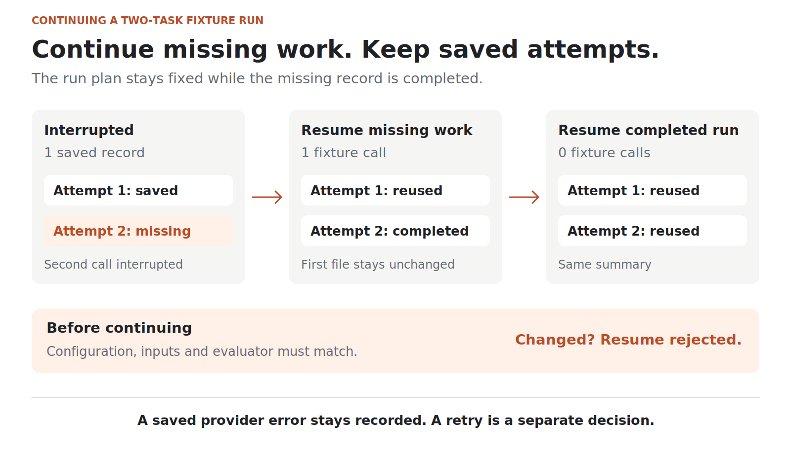

# Resuming an eval without changing the experiment

An eval stops halfway through. There is already an answer on disk, and another task has not finished.

What should happen when we run it again?

The easy part is skipping a file that already exists. The harder part is deciding whether that file still belongs to the experiment we are about to continue.

If the prompt changed, the grader changed, or a failed request quietly gets another chance, we may end up with a different experiment under the same directory name.

This is the next case study in the series, after [What exactly are AI evals?](https://dev.to/deavgprime/what-exactly-are-ai-evals-775) and [Before scoring a model, test the evaluator](https://dev.to/deavgprime/before-scoring-a-model-test-the-evaluator-3noi). This time, I am looking at the runner around the scorer in [IaC Eval Bench](https://github.com/deavgprime/iac-eval-bench).

**On this page**

- [What resume means here](#what-resume-means-here)
- [Interrupting a two-task run](#interrupting-a-twotask-run)
- [What must stay the same](#what-must-stay-the-same)
- [A recorded failure is still an attempt](#a-recorded-failure-is-still-an-attempt)
- [Try the checks locally](#try-the-checks-locally)
- [The boundary a checkpoint cannot solve](#the-boundary-a-checkpoint-cannot-solve)

## What resume means here

For this project, a resume does three things:

1. Checks that the run configuration, inputs, evaluator, and recorded validation runtime still match.
2. Validates and reuses the attempt records already saved.
3. Runs the missing attempts and rebuilds the reports.

A completed response can pass or fail the task. Either way, it is an attempt to keep. A recorded provider error is also retained.

A retry asks for another attempt. A resume continues the same planned set of attempts. Those are different decisions, and I do not want one to happen silently inside the other.

## Interrupting a two-task run

I used two of the benchmark's tasks: a Deployment configuration and a Service configuration. Both used the project's saved reference fixtures.

These are constructed checks of the runner. They do not call a model or measure model quality.

For the interruption check, a controlled exception stops the fixture provider before the second attempt returns. The first attempt has already been written to disk. The runner is then called again with the same configuration and `resume=True`.

Here is what happened:

| Step | Saved records | Fixture calls during this step |
| --- | --- | --- |
| Before the controlled interruption | One completed attempt | Two calls entered; the second was interrupted |
| Resume the missing work | Two completed attempts | One |
| Resume the completed run again | The same two attempts | Zero |

The first attempt file stayed byte-for-byte unchanged. After the first resume, both reference tasks passed. The second resume returned the same summary without calling the fixture provider again.



*Figure 1. A controlled fixture example. The saved record stays; only missing work is continued.*

The useful result is not the two passing grades. It is that continuing the run did not replace its earlier evidence or add an unplanned attempt.

## What must stay the same

A directory name cannot tell us whether two runs mean the same thing.

IaC Eval Bench records a fingerprint derived from the configuration, task definitions, schema manifest, harness source, fixture contents where applicable, and Python and validation dependency versions. On resume, it recomputes that fingerprint and checks the saved manifest's provenance fields as well.

The source of this behavior is inspectable in the [runner](https://github.com/deavgprime/iac-eval-bench/blob/1dbabecd8cc377cef1082b2652131b6921c4c74b/src/iac_eval_bench/runner.py). It is a specific contract for this small project, not a requirement that every evaluation framework must use the same fields.

I checked four ways that continuing a saved run could go wrong:

| Change before resuming | Observed result |
| --- | --- |
| Change the configured seed from 42 to 99 | Rejected: configuration, inputs, or evaluator changed |
| Add a newline to a selected fixture file | Rejected: configuration, inputs, or evaluator changed |
| Change the saved manifest's harness version | Rejected: manifest provenance does not match |
| Change an attempt's score without updating its checksum | Rejected: attempt integrity check failed |

The [recorded observations](https://github.com/deavgprime/iac-eval-bench/blob/98b7ec20d8a8bd3acf308e56f9a6d8ee75be2b57/docs/examples/resume-observations.json) include the continuation checks, rejection messages, and CLI exit codes.

The newline case is deliberately strict. The fixture means the same thing as JSON, but its bytes changed. This implementation compares content hashes rather than trying to prove that two inputs are semantically equivalent.

If I want to compare a new prompt or a changed grader, I should use a new output directory and record a new run. Keeping the old run lets me explain what changed.

The fingerprints also have limits. They do not establish which remote model weights a server actually loaded. A user-supplied model revision is recorded, not independently verified. A requested seed does not guarantee identical generation across machines or model servers.

## A recorded failure is still an attempt

Suppose a provider request fails and the runner saves that error. On resume, should the runner try it again?

In this project, it does not. I checked that separately by injecting two provider errors, then resuming with the fixture function configured to fail the test if called.

The resumed run made zero provider calls and retained both errors.

There were no completed answers, so the quality pass rate was unknown. The operational pass rate was zero: none of the two planned attempts produced a passing result.

This distinction matters when reading a report. A failed request is not evidence that the model produced a wrong configuration. It is still evidence that the evaluation attempt did not succeed operationally.

An intentional retry belongs in a separately named run under this project's current interface. It should not erase the first failure or quietly improve the original run's headline result.

## Try the checks locally

The previous case study includes the [environment setup](https://dev.to/deavgprime/before-scoring-a-model-test-the-evaluator-3noi#run-the-checks-yourself). Use the same pinned revision, `1dbabecd8cc377cef1082b2652131b6921c4c74b`, with its locked dependencies.

From that checkout, create a small run:

```bash
iac-eval run --provider fixture --fixture-dir fixtures/reference \
  --task deployment-resources --task service-routing \
  --output runs/resume-demo
```

Run the same command with `--resume`:

```bash
iac-eval run --provider fixture --fixture-dir fixtures/reference \
  --task deployment-resources --task service-routing \
  --output runs/resume-demo --resume
```

This reuses the two saved attempts. It is a completed-run check, not a simulation of an interruption.

Now change the seed while keeping the same output directory:

```bash
iac-eval run --provider fixture --fixture-dir fixtures/reference \
  --task deployment-resources --task service-routing \
  --seed 99 --output runs/resume-demo --resume
```

The command exits with code 2 and reports:

```text
error: resume rejected: configuration, inputs or evaluator changed
```

Use a fresh output directory if `runs/resume-demo` already contains evidence you want to keep.

For the controlled interruption and the related regression checks, run the existing runner tests:

```bash
python -m unittest discover -s tests -p test_runner.py -v
```

The tests cover partial-run continuation, duplicate generation, changed configuration, record integrity, locks, and recorded provider failures. The full suite has 51 test methods; it also covers the scoring cases from the previous post.

## The boundary a checkpoint cannot solve

There is an important gap between making a provider request and saving its result.

If a process stops after the provider has produced an answer but before the attempt record is written, the runner has no completed record to reuse. A later resume can make that request again. The provider might have charged for the first request even though the local report never recorded it.

Writing attempt files atomically protects the local checkpoint transition. It does not make a remote request and a local file write one indivisible operation. This implementation does not guarantee exactly-once execution at the provider.

There are other practical boundaries too:

- The directory lock stops competing local writers. An abrupt stop can leave a stale lock. Check that no runner is active before removing it.
- Checksums detect a record changed without a matching checksum. They are not signatures and do not prove authenticity against someone who can rewrite both.
- Rebuilding a report from saved attempts does not mean rerunning those answers through a different grader. A changed grader requires a new experiment under the current resume contract.

These checks used local fixtures and controlled faults. They establish the specific continuation and rejection behavior described above. They do not test a live provider outage or a machine losing power during a request.

The question I now ask of a resumable eval is simple: did it continue the same experiment, and can I still account for every attempt?
