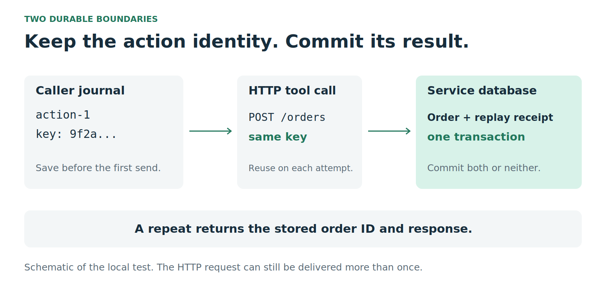
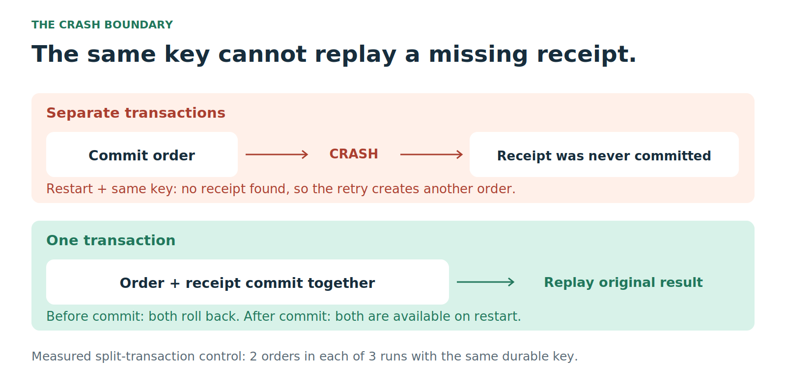

# Making agent retries safe across timeouts and restarts

**Imagine an enterprise support agent ordering an approved replacement for a customer. The order goes through, but the confirmation times out. The agent retries and reports success. Two orders are now queued for fulfillment, and the support team has a duplicate to sort out.**

That sequence is easy to miss if the only thing you check is whether the retry succeeded. To reproduce it, this experiment uses a small HTTP order service and a scripted tool caller. In the first timeout case, the caller gave up after about 101 ms. The order had already been committed. Retrying created another row with the same tenant, product and quantity. The caller saw one timeout followed by a successful `201 Created`.

The failure sits between the tool and the service, so reproducing it does not require a model. The setup uses two SQLite databases, one for the caller's saved state and one for the service's orders. All failures are injected locally. This is a deployment exercise, not a report from a customer environment.

Across three rounds, the experiment recorded **117 scenario runs and 288 HTTP requests**, keeping failed attempts alongside successful ones. Reusing a saved operation key prevented duplicates in several cases. It was not enough when the service had no record of the earlier request, whether because that record was never saved or had already been deleted.

## What happens between a tool call and its result

For the replacement order in the opening example, the tool request could be as small as this:

```http
POST /orders
Content-Type: application/json

{"sku":"keyboard","quantity":1}
```

The service can commit this order and lose the connection before the response reaches the caller. To make that timing reproducible, the test gives the caller a 100 ms socket timeout and makes the service hold its response for 500 ms after committing. Here is the caller's record, with unrelated fields omitted:

```json
{
  "fault": "timeout_after_commit",
  "timeout_seconds": 0.1,
  "status": null,
  "error_type": "TimeoutError",
  "error": "timed out",
  "elapsed_ms": 100.892311
}
```

The exception tells us how long the caller waited. To find out whether the order exists, we have to look at the server trace and database. Raising the timeout above 500 ms would let this particular response arrive, but it would leave the connection-drop and process-crash cases unresolved.

That is why increasing timeouts or adding backoff cannot settle the duplicate-order problem on its own. As AWS explains in its guidance on [timeouts and retries](https://aws.amazon.com/builders-library/timeouts-retries-and-backoff-with-jitter/), a failed call can still have side effects. Once the order is committed, a retry needs a way to identify it as work already done.

## Three retry strategies, the same faults

An idempotency key gives the service an identifier it can recognize when the caller retries. To check what that actually protects, the experiment runs each scenario with three ways of identifying the request:

| Strategy | What the caller sends |
| --- | --- |
| No key | The same payload again, without an operation identifier |
| New key per attempt | A new UUID for every HTTP request |
| Durable action key | One UUID saved for the intended action before the first request, then reused |

The service supports keys throughout. What changes is the caller: it either omits the key, replaces it on every attempt, or saves and reuses it. A fresh UUID on each request still makes every retry look like new work, even though the payload has not changed.

The results below count **orders created in one scenario run**. Counting successful responses would miss the original problem. All three repetitions produced these counts.

| Injected condition | No key | New key per attempt | Durable action key |
| --- | ---: | ---: | ---: |
| Response arrives normally | 1 | 1 | 1 |
| Caller times out after commit | 2 | 2 | 1 |
| Connection closes after commit | 2 | 2 | 1 |
| Service exits before commit, then restarts | 1 | 1 | 1 |
| Service exits after commit, then restarts | 2 | 2 | 1 |
| Caller process dies before its completion checkpoint | 2 | 2 | 1 |
| Eight concurrent deliveries of one intended action | 8 | 8 | 1 |
| All three responses are dropped | 3 | 3 | 1 |

Notice the difference between a service exit before and after commit. Before commit, there is no saved order, so the next attempt should create one. After commit, creating another would be a duplicate. The service needs to return the result of the original order instead.

These counts describe deliberately injected faults, not their frequency in production traffic. They establish which behavior each strategy produces. To understand why the durable key works here, we need to follow where it is stored and how the service uses it.

## Keep the identity outside the model conversation

For the support workflow, the key belongs to the approved replacement order. Retrying its HTTP request does not mean the customer approved another order.

The caller therefore saves a mapping from `(tenant, action)` to a random UUID before making the first request. A fresh invocation looks up the same action and gets the same key. Storing that mapping in SQLite lets it survive a caller restart; keeping it in a Python variable would not.



This only works if the workflow preserves the action identifier as well. After a restart, the test resumes `action-1` and retrieves its saved key. Generating a new action ID at that point would lose the protection before the next HTTP request was sent. The same applies to model-driven tool calls: an SDK retry, a workflow retry and a resumed invocation may all be attempts to complete one approved action. Their identity needs to come from saved workflow state.

Two genuinely separate orders can have identical payloads. If a customer intentionally orders two keyboards in two transactions, hashing the payload as the operation key would incorrectly collapse the second order into the first. The distinct-action control sends the same payload with two action identities and correctly creates two orders.

A payload hash is still useful, but for a different check: whether a caller has changed the request while reusing an existing key. That check belongs on the service side.

## The service has to make a promise it can keep

Recognizing the key is only half the job. The service also needs to know what happened when it first received that key. It stores a replay receipt: a record of the key, request fingerprint, response status and response body. When the same key and payload arrive again, the service returns that saved response, including the original order ID.

The order and its receipt are written together:

```text
BEGIN IMMEDIATE
  look up (tenant, operation, key)
  if a receipt exists:
    reject a different payload, or return the saved response
  otherwise:
    insert the order
    insert its replay receipt
COMMIT
```

Both inserts occur in one transaction. If storing the receipt fails, the order insert rolls back too. One regression test forces exactly that failure with a SQLite trigger, then verifies that a later valid request can still create the order.

For concurrent deliveries, this example acquires the write transaction before reading the receipt. SQLite allows only [one writer at a time](https://www.sqlite.org/lang_transaction.html). That makes the eight-request result straightforward: one request creates the order, and the other seven replay its result.

This choice also serializes unrelated writes. It is convenient for a small reproduction, but the test says nothing about its throughput at customer scale. A different database needs its own tested locking and conflict-handling path.

There are also boundaries the service must enforce when looking up a receipt. The key is scoped to the tenant and operation, so the same UUID in another tenant must not return the first tenant's order. The local test uses a header to supply tenant identity; a deployed service would have to obtain and authorize that identity from authenticated context. Possessing a key is not permission to see its result.

Within that scope, the request fingerprint prevents a key from being reused for different work. Changing the quantity returns `409` and creates no second order. Reordering the JSON fields remains a replay, because the fingerprint is computed from canonicalized input. Invalid quantities are rejected before the key is consumed.

These are explicit service semantics. Providers may make different choices about saved errors and retention. For example, [Stripe documents its own replay and parameter-matching rules](https://docs.stripe.com/api/idempotent_requests); copying a header name does not copy that contract.

## A key did not fix the split transaction

The transaction around both writes may look like a small implementation detail. To test whether it matters, one comparison mode commits the order first and saves the receipt in a separate transaction.

The service then exits between those writes. After restarting, it has an order but no receipt. The caller retries with the original durable key, but the service finds nothing to replay and creates another order. The saved events show where the duplicate comes from:

```text
order_committed_without_receipt  order A
process exits
request received with same key
committed                        order B
response_sent                    201
```

This excerpt shortens the UUIDs for readability. The complete events retain both IDs and timestamps.



All three repetitions produced **two orders**, despite the stable key. The missing guarantee was atomic storage of the effect and its replay record.

AWS's article on [idempotent APIs](https://aws.amazon.com/builders-library/making-retries-safe-with-idempotent-APIs/) makes the same requirement explicit: recording the request token and performing the mutations need to be an atomic operation.

That boundary becomes harder when the effect belongs to another system. A local database transaction cannot roll back a payment that an external provider has already accepted. The provider needs to recognize the same operation identity, or the integration needs a way to query and reconcile the outcome. Queuing the work through an outbox can make the local handoff durable, but the receiver still has to tolerate repeated delivery.

This experiment does not implement a payment provider, an outbox or cross-service recovery. Its guarantee ends at the order service's database.

## Stopping retries does not establish failure

Even with both writes in one transaction, the workflow still has a problem if confirmation never arrives. Another scenario drops every response and stops after three attempts. The durable key keeps the final database at one order, but the caller has only three connection failures to work with. Its outcome remains `unknown`.

Reporting that operation as failed would be misleading. Automatically starting a new action with a fresh key could create another order. A workflow needs a distinct path for an unresolved outcome: retain the original identity, reconcile through an authorized lookup or repeat request when safe, and escalate if it cannot establish what happened.

For the support team, this means the workflow should not say either “replacement failed” or “replacement confirmed” based on those responses alone. An evaluation needs to capture the same distinction. A checker that sees only tool exceptions might count three failed operations; one that sees only the database might call the workflow successful. What actually happened is more specific: one order was created, duplicates were prevented, and the caller never received confirmation.

Retry limits, backoff and a total deadline still matter. The example uses fixed attempt counts to expose correctness; it does not test a production backoff policy or retry storms. Its socket timeout is not a complete workflow deadline.

## How long does the protection last?

Keeping an unresolved action for later recovery raises another question: will the service still recognize it when the workflow resumes?

A final test deletes the replay receipt after a successful request, then sends the same key again. The service creates a second order. This models lost replay history rather than testing expiry against a clock, but it exposes the dependency: retaining the key on the caller is not enough if the service has forgotten it.

The retention window therefore needs to account for how long a workflow can remain paused, not just the few seconds an HTTP library spends retrying. Before enabling automatic recovery, the deployment needs an answer for what happens when an approved action resumes outside that window.

A durable business identifier with a uniqueness rule may provide longer protection than a temporary response cache. Where that is unavailable, a late resume may need reconciliation rather than another create request.

## Run it and inspect the records

The source keeps these failure modes together so you can compare them against the same service. It runs on Linux with Python 3.11 or newer, uses only the standard library, and starts local processes listening on `127.0.0.1`.

```bash
git clone https://github.com/deavgprime/iac-eval-bench.git
cd iac-eval-bench
git switch --detach 5de3e73a495878377f57324e9947f2e90ca89554
python3 docs/examples/safe_retries.py run \
  --output runs/safe-retries \
  --repetitions 3
python3 -m unittest discover -s tests -p test_safe_retries.py -v
```

Use a fresh output directory each time. The driver refuses to overwrite an existing run.

The [saved evidence](examples/safe-retries-results/README.md) includes every client attempt, the server events and final order/receipt snapshots. The [source](examples/safe_retries.py) includes the unsafe comparison modes, so the duplicate behavior can be reproduced as well as the protected path.

The recorded run used Python 3.12.3 and SQLite 3.45.1. It completed in 29.26 seconds, with 18.53 CPU seconds across child processes. The driver and largest child each reached a reported peak RSS of about 29.4 MiB. Those are per-process peaks, not total concurrent memory. Event logging flushes to disk and affects timing, so these measurements describe the test workload rather than service performance.

The crash tests terminate processes; they do not test a host outage, disk failure or regional failover. The fault headers are test controls, not an interface to expose in a deployment.

For a tool that creates orders, the first test worth borrowing is the one that started this article: commit the write, lose its response, then retry through the real workflow. Check how many orders exist, whether the workflow kept the same action identity, and what it tells the support team. A green status after the retry is not enough to answer any of those questions.
