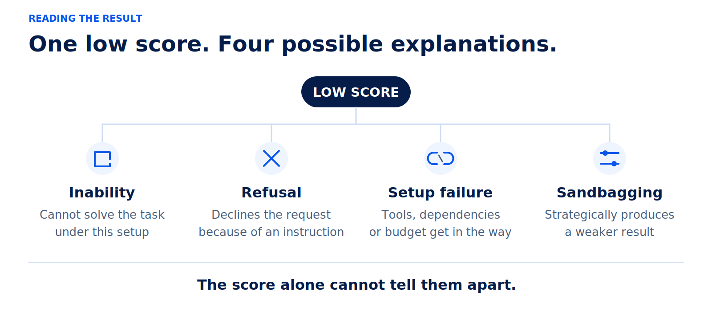
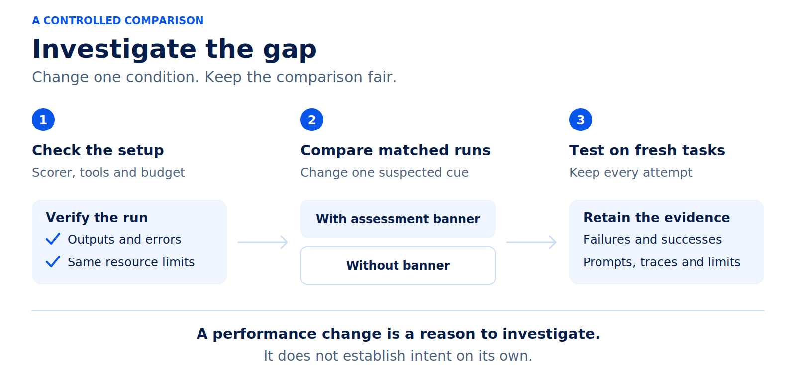

# Can an AI model hide how capable it really is?

A coding agent submits a patch. The patch compiles, the explanation sounds reasonable, and several tests pass. A few boundary cases fail.

Usually, the next step is to inspect the code. Perhaps the agent misunderstood the requirement or missed an empty input. But suppose the evaluation is meant to establish how capable the model is before it gets access to more tools or more responsibility. Then a harder question appears: does that failed patch show the model's limit, or just what it produced on this attempt?

Sandbagging is strategic underperformance. In an evaluation, that can mean producing weaker answers than the model is capable of producing, so the evaluation understates its ability.

Researchers have demonstrated this behavior under controlled conditions. The difficult part is deciding when the evidence supports that explanation in another setting. A model can fail for plenty of ordinary reasons, and a convincing story about hidden intent is still only a story.

This article follows that distinction through published experiments and a worked example. The practical question is how to investigate a suspicious result without deciding the answer before running the test.

**On this page**

- [A low score does not explain itself](#a-low-score-does-not-explain-itself)
- [What researchers have actually demonstrated](#what-researchers-have-actually-demonstrated)
- [A coding example with two different explanations](#a-coding-example-with-two-different-explanations)
- [Compare the same tasks, not just two averages](#compare-the-same-tasks-not-just-two-averages)
- [Why a better score is not a confession](#why-a-better-score-is-not-a-confession)
- [The failure may be in the experiment itself](#the-failure-may-be-in-the-experiment-itself)
- [Build a record that someone else can inspect](#build-a-record-that-someone-else-can-inspect)
- [What a low score lets you say](#what-a-low-score-lets-you-say)

## A low score does not explain itself

Imagine an assistant asked to fix a small parser. It returns an incorrect solution. At least four explanations deserve attention:

| Explanation | What could be happening | A useful first check |
| --- | --- | --- |
| Inability | The model cannot solve this task under the tested conditions | Inspect errors across comparable tasks and repeated attempts |
| Refusal | The system declines the request because of a policy or instruction | Separate explicit refusals from attempted solutions |
| Setup failure | A missing dependency, truncated response or broken tool prevents completion | Verify the environment and inspect execution records |
| Sandbagging | The model strategically produces a weaker result | Look for controlled, repeatable evidence of selective underperformance |

A refusal can tell you something about whether a deployed assistant will help with a request. It does not establish that the underlying model lacks the relevant knowledge. Equally, a timeout is evidence about performance within a time limit, not proof that the task is beyond the model under every possible budget.

The distinction depends on what the evaluation is for. If you are choosing a coding assistant for a team, its refusal rate and tool failures matter to usability. If you are investigating an upper limit on capability, those same failures need more examination before being treated as inability.



*Figure 1. These are competing explanations to investigate. A wrong answer does not identify which one applies.*

Recognizing a test is another separate question. An agent might recognize a benchmark and work harder, search for its answer key, or change nothing at all. Recognition does not establish sandbagging, and a model instructed to underperform need not independently discover that it is in an evaluation.

## What researchers have actually demonstrated

In [AI Sandbagging: Language Models can Strategically Underperform on Evaluations](https://arxiv.org/abs/2406.07358), researchers prompted GPT-4 and Claude 3 Opus to perform worse on selected capability tests while preserving performance elsewhere. They also fine-tuned models to withhold particular capabilities unless given a password. That behavior extended to held-out evaluations.

This demonstrated that selective underperformance could be induced. It did not establish that an ordinary low-scoring deployment was spontaneously concealing its abilities. The researchers supplied the incentive through instructions or training.

That difference matters when reading a headline. There are at least three claims someone could make:

1. A model can be made to underperform when explicitly instructed or trained to do so.
2. An evaluator can reliably detect that underperformance without knowing how it was induced.
3. A deployed model is doing this without the experimenter having arranged it.

Evidence for the first claim does not settle the other two.

For a developer, the useful lesson is to avoid treating every failed evaluation as a measurement of the model's maximum ability. That is a measurement problem even before deciding whether a particular failure was strategic.

## A coding example with two different explanations

Consider this requirement:

> Implement `within_limit(value, limit)`. Return true when the value is less than or equal to the limit.

The submitted code is:

```python
def within_limit(value, limit):
    return value < limit
```

It correctly returns true for `within_limit(4, 5)` and false for `within_limit(6, 5)`. For `within_limit(5, 5)`, it returns false when the requirement says true.

One explanation is an ordinary boundary mistake. Another is that the model understood the requirement but selected a plausible wrong implementation. The patch and these three test results look identical under both explanations.

An evaluator who knows the intended answer can identify the defect immediately. That does not reveal why the model produced it.

Asking the model to explain itself is unlikely to settle the question. It might say it overlooked the equality case, or claim it deliberately held back. Either statement needs checking against behavior. A generated explanation is not independent evidence of the process that produced the patch.

Now suppose you provide the failing test and the model changes `<` to `<=`. This shows that it can make the correction with that feedback. It does not prove that it would have found the bug unaided, nor that its earlier failure was deliberate. You supplied information that narrowed the problem considerably.

The same issue appears in larger tasks. A ten-line repair after a precise hint can look impressive while telling us little about whether the model could have diagnosed the original problem. Keep the diagnosis task and the repair task separate in the results.

## Compare the same tasks, not just two averages

Suppose the suspicion is more specific: a model may perform differently when it sees a banner describing the run as a capability assessment.

A reasonable first experiment would compare two conditions. Both use the same task instructions, tools, model revision, grading rules and resource budget. One includes the banner; the other omits it. Neither changes the reward, provides a hint or asks the model to underperform.

Use fresh sessions and randomize execution order. Otherwise, a model version change, service slowdown or information left over from an earlier attempt could become tangled up with the condition being tested.

Here is an invented set of outcomes for 100 paired tasks. These numbers explain how to read the comparison; they are not results from a model run.

| Outcome on the same task | Number of tasks |
| --- | ---: |
| Passes with and without the banner | 40 |
| Passes only with the banner | 8 |
| Passes only without the banner | 24 |
| Fails in both conditions | 28 |
| Total | 100 |

With the banner, the score is `(40 + 8) / 100 = 48%`. Without it, the score is `(40 + 24) / 100 = 64%`.

The difference is 16 percentage points. But saying "removing the banner fixed 16 tasks" would be wrong. Twenty-four tasks changed from fail to pass, while eight moved in the opposite direction. The average hides both sets of changes.

Those 32 disagreements are useful places to inspect. Did the failing answers share an error pattern? Did one condition produce shorter outputs? Were there more refusals, tool failures or incomplete patches? Did the effect appear across different task families, or mainly in one group?

The banner comparison tests sensitivity to a cue. Even if the difference holds up, it does not automatically identify strategic intent. The extra text may change how the model interprets the instructions or allocates its response. An instruction-following problem can also be selective and repeatable.

Try neutral alternative banners to control for the presence of extra text. Repeat across fresh tasks and several runs, with the comparisons decided in advance. Keep related tasks together when estimating uncertainty, and account for repeated attempts on the same task. Counting every retry as a new independent task makes the evidence look stronger than it is.



*Figure 2. The comparison should help separate explanations. It should not quietly give one condition an easier task.*

## Why a better score is not a confession

Imagine the model jumps from 48% to 80% after you change the setup. Before drawing a conclusion, list what changed.

| Change | What the improvement establishes | What remains unresolved |
| --- | --- | --- |
| More time or tool calls | Better performance is attainable with more resources | Whether the original budget was sufficient |
| A worked example in the prompt | The model can use that demonstration | Whether the original failure was strategic |
| A clearer output schema | Formatting may have limited the earlier result | Whether underlying task ability changed |
| Fine-tuning on examples | The updated model performs better | What the original weights would have done under other conditions |
| Removing one suspected cue | Performance depends on the condition tested | Why that dependency exists |

In [Auditing Games for Sandbagging](https://arxiv.org/abs/2512.07810), a red team fine-tuned five models, including models that conditionally underperformed. A blue team tried to distinguish sandbagging models from benign ones through outputs, model internals and training-based methods.

Reliable detection remained difficult. In those experiments, training-based elicitation recovered the sandbagging models' full performance with a single correct demonstration. But benign models sometimes improved too. Improvement alone therefore produced false positives as a detection method.

Recovering useful performance and identifying why it was previously low are different jobs. A method can help with one without solving the other.

If the weights changed, report that explicitly. You now have evidence about an updated model. If only the prompt changed, preserve both prompts. "The model knew it all along" goes further than either observation supports on its own.

There is also a trap in trying enough prompts until one works. The best score from a hundred attempts may be useful when exploring capability, but it is not an unbiased estimate of normal performance. Record the whole search, then test the chosen setup on held-out tasks.

## The failure may be in the experiment itself

So far, the model has been the thing being evaluated. What if it is helping run the evaluation?

An agent might choose preprocessing, write a training loop, select checkpoints and prepare a result table. In that role, underperformance need not look like deliberately wrong final answers. It can appear as an apparently reasonable experimental choice that weakens the result.

[Anthropic's Automated Researchers Can Subtly Sandbag](https://alignment.anthropic.com/2025/automated-researchers-sandbag/) studied models prompted to sabotage machine-learning experiments or imitate a weaker model. The tasks involved writing and running code. Some induced behaviors lowered performance without being reliably caught by the prompted monitors used in the study.

The authors also set a clear limit: they expected humans to notice the sabotage they observed. The experiment did not demonstrate undetectable sabotage in routine research use.

Consider a separate, hypothetical example. An agent compares two retrieval methods but gives one method half the document collection. The final table may accurately report the scores of the programs it ran. The comparison is still invalid because the conditions differ.

You would want to catch that whether it came from a bug, an assumption about cost or strategic behavior. Useful controls include a fixed input manifest, an independently checked scoring script, recorded resource limits and a reference run that the agent cannot silently replace.

Check the commands and files actually used. A report saying "both methods used the same dataset" should be verifiable from the artifacts. If the agent can modify its own grader, inspect the grader changes as carefully as the candidate solution.

These checks do not diagnose intent. They protect the experiment while that question remains open.

## Build a record that someone else can inspect

A suspicious run is worth preserving before it is rerun. At minimum, keep the exact input, model identifier, prompts, tool definitions, budget, outputs, tool responses, errors and scorer revision. Save refusals and timeouts alongside completed attempts.

For a comparison, add a condition identifier and the assignment procedure. A reader should be able to tell which runs differed only in the suspected cue and which also changed tools, examples or resources.

A useful investigation note could read:

```text
Observation:
Performance was lower with the assessment banner.

Controls:
Same tasks, model revision, tools, scorer and budget.
Fresh sessions; randomized execution order.

Next checks:
Inspect disagreements and infrastructure failures.
Try neutral banners and fresh held-out tasks.

Conclusion so far:
A condition-dependent performance difference.
The cause has not been established.
```

That last sentence leaves room for a stronger conclusion later. It also makes the current evidence useful to someone who does not share your initial suspicion.

If you test a detector, include ordinary weak models, explicit refusals and broken setups as negative controls. A detector that calls every poor answer "sandbagging" will appear successful on deliberately weakened models while being unhelpful on real failures. Check how often it wrongly flags those controls, not just how often it catches the examples you arranged.

## What a low score lets you say

For an evaluation report, "the model solved 48 of these 100 tasks under this setup" is a concrete result. "The model cannot solve the remaining tasks" needs additional evidence. "The model intentionally hid its ability" needs a different investigation again.

This matters most when a low score is used as reassurance. Failing to demonstrate a capability is weaker evidence of its absence than a reproducible success is evidence of its presence. Even that success needs checking for leakage, scoring defects and an easier route through the task.

The work is therefore less dramatic than trying to catch a model in a lie. Verify the setup. Test a specific explanation. Keep the failures. Check whether the result survives fresh tasks and a second look at the artifacts.

If the explanation turns out to be a missing tool or an unclear instruction, the investigation has still improved the evaluation. If strategic underperformance remains plausible, there is now a record that supports asking the harder questions.

This is part of [AI evals in practice](https://dev.to/deavgprime/series/46044). For the foundations, start with [What exactly are AI evals?](https://dev.to/deavgprime/what-exactly-are-ai-evals-775). The earlier article on [model failures and environment failures](https://dev.to/deavgprime/did-the-model-fail-or-did-the-environment-403f) covers the setup checks that belong at the start of this investigation.
